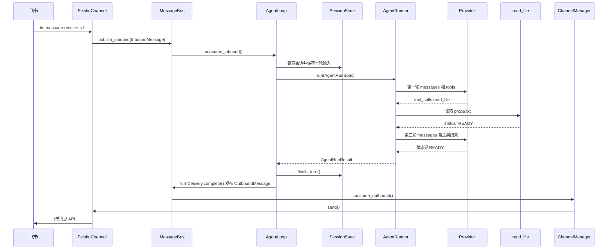

# nanobot 源码说明与飞书消息执行流程

本文基于包含项目 Skill 支持的 nanobot 源码。主线选取一条已授权的飞书私聊文本消息，追踪它如何进入会话、组装模型请求、执行 `read_file`，再把回复发回原私聊。群聊、流式卡片和项目子 Agent 在各自的分支中说明。文末记录一次本地实际走通的调用。

## 1. 模块地图

Python gateway 承载运行时。飞书、WebUI、TUI 和 Python SDK 使用各自的入口，模型执行、工具权限和会话状态由 Python 模块负责。阅读一条消息的主线时，`FeishuChannel` 负责协议适配，`AgentLoop` 负责一轮会话，`AgentRunner` 负责这一轮里反复发生的模型请求与工具调用。

| 模块 | 职责 | 源码入口 |
| --- | --- | --- |
| CLI 与 gateway | 读配置，装配共享总线、会话、Provider、工具和渠道，启动与关闭运行时。`gateway/` 也管理本地 gateway 进程和服务。 | [gateway 装配](../nanobot/cli/gateway_runtime.py#L582) · [进程管理](../nanobot/gateway/runtime.py) |
| 配置与运行目录 | 定义配置结构、加载实例配置、解析 workspace、数据目录和配置路径。 | [schema.py](../nanobot/config/schema.py) · [loader.py](../nanobot/config/loader.py) · [paths.py](../nanobot/config/paths.py) |
| 渠道与配对 | 把各聊天平台消息转换为统一输入，做渠道授权、格式转换和发送。`ChannelManager` 管理渠道生命周期和出站调度。 | [base.py](../nanobot/channels/base.py) · [manager.py](../nanobot/channels/manager.py) · [飞书运行时](../nanobot/channels/feishu/runtime.py) · [配对存储](../nanobot/pairing/store.py) |
| 消息与事件 | `MessageBus` 分别维护入站、出站队列，也支持本地事件订阅。`InboundMessage`、`OutboundMessage` 和运行时事件是各模块之间的契约。 | [queue.py](../nanobot/bus/queue.py) · [events.py](../nanobot/bus/events.py) · [runtime_events.py](../nanobot/bus/runtime_events.py) |
| 会话调度 | `AgentLoop` 从总线取消息，按会话排队，处理命令、恢复、上下文、持久化和响应。 | [loop.py](../nanobot/agent/loop.py) · [命令路由](../nanobot/command/router.py) |
| 模型执行 | `AgentRunner` 组装初始 transcript，执行多轮模型与工具请求，处理重试、流式输出、后续输入和终止条件。 | [runner.py](../nanobot/agent/runner.py) · [turn_hooks.py](../nanobot/agent/turn_hooks.py) |
| 上下文与技能 | `ContextBuilder` 组装系统消息与本轮输入。`SkillsLoader` 发现技能、注入自动启用或显式选择的内容。`ContextGovernor` 管理发送给模型的上下文预算。 | [context.py](../nanobot/agent/context.py) · [skills.py](../nanobot/agent/skills.py) · [context_governance.py](../nanobot/agent/context_governance.py) · [模板目录](../nanobot/templates/) |
| Provider | 根据配置和会话预设选择模型与适配器，把统一消息和工具定义转换为实际 API 协议，再解析成统一响应。 | [routing.py](../nanobot/providers/routing.py) · [factory.py](../nanobot/providers/factory.py) · [Provider 基类](../nanobot/providers/base.py) |
| 工具和进程 | 工具加载器注册可用能力，注册表解析和验证参数，执行器调用具体工具。Shell 工具另有进程会话、超时和取消管理。 | [loader.py](../nanobot/agent/tools/loader.py) · [registry.py](../nanobot/agent/tools/registry.py) · [工具执行](../nanobot/agent/tools/execution.py) · [exec_session.py](../nanobot/agent/tools/exec_session.py) · [进程树](../nanobot/execution/processes.py) |
| 工具权限 | 解析会话工作区，限制文件访问，检查 shell 命令，按配置启用 OS 沙箱，保护 HTTP 工具的网络访问。 | [workspace_access.py](../nanobot/security/workspace_access.py) · [workspace_policy.py](../nanobot/security/workspace_policy.py) · [sandbox.py](../nanobot/agent/tools/sandbox.py) · [network.py](../nanobot/security/network.py) |
| 会话、恢复和记忆 | Session 保存会话消息与 Provider 状态。`SessionState` 协调持久化和检查点，SQLite 存储可重放历史及单独的显示历史。长期记忆由 workspace 中的记忆文件和整合流程管理。 | [manager.py](../nanobot/session/manager.py) · [state.py](../nanobot/session/state.py) · [sqlite_store.py](../nanobot/session/sqlite_store.py) · [恢复](../nanobot/session/recovery.py) · [memory.py](../nanobot/agent/memory.py) |
| 子任务与项目 worktree | `SubagentManager` 管理后台执行、父子归属和任务记录。配置了项目的子任务可以绑定独立 worktree，保存结果并通知原会话。 | [子任务工具](../nanobot/agent/tools/subagent.py) · [subagent.py](../nanobot/agent/subagent.py) · [项目 worktree](../nanobot/agent/subagent_project.py) |
| 定时、触发与 Goal | Cron 管理定时作业，Triggers 接入本机触发，Goal 管理持续任务。它们可以向运行时提交内部执行或交付事件。 | [cron/service.py](../nanobot/cron/service.py) · [triggers/local_runner.py](../nanobot/triggers/local_runner.py) · [goal/runtime.py](../nanobot/goal/runtime.py) |
| WebUI、TUI 与 SDK | WebUI 和 TUI 提供客户端界面，WebSocket 渠道承接传输。SDK 提供 Python 调用入口。浏览器的显示记录与模型历史分别管理。 | [webui](../webui/) · [tui](../tui/) · [WebSocket 渠道](../nanobot/channels/websocket/runtime.py) · [SDK](../nanobot/sdk/clients.py) |
| 外部能力与安装更新 | CLI Apps 和 MCP 将外部工具接入运行时。音频模块负责音频相关能力。发布、安装和重启模块管理运行时自身的更新。 | [CLI Apps](../nanobot/apps/cli/) · [MCP 工具](../nanobot/agent/tools/mcp.py) · [audio](../nanobot/audio/) · [更新服务](../nanobot/update_service.py) |

## 2. 一条飞书私聊消息如何进入 Agent

以下用「请读取 probe.txt 并告诉我状态」作为例子。`om_001` 是入站消息 ID，`ou_alice` 是示例发送者 open ID。消息 ID 用于去重和引用，回复地址用于发送，会话键用于找历史和排队。



### 2.1 启动与入站

1. gateway 创建一份共享的 `MessageBus`，初始化 `SessionManager`、Provider、`ToolRegistry` 和 `AgentLoop.from_config()`。它分别启动 `agent.run()` 与 `channels.start_all()`，渠道管理器再启动启用的渠道和出站消费循环。[gateway 装配](../nanobot/cli/gateway_runtime.py#L582) · [启动并发任务](../nanobot/cli/gateway_runtime.py#L1016) · [ChannelManager.start_all](../nanobot/channels/manager.py#L622)
2. `FeishuChannel.start()` 创建 Lark SDK 的 API client 与 WebSocket client，并把 `_on_message_sync()` 注册给消息事件。`FeishuWsRunner` 承载长连接。回调通过 `asyncio.run_coroutine_threadsafe()` 把 `_on_message()` 调度到 gateway 的 asyncio loop。[飞书启动](../nanobot/channels/feishu/runtime.py#L1080) · [长连接执行器](../nanobot/channels/feishu/websocket.py#L45) · [回调交接](../nanobot/channels/feishu/runtime.py#L2541)
3. `_on_message()` 检查事件字段、过滤机器人消息、应用群聊提及策略、按消息 ID 去重并检查发送者。未授权私聊可以收到配对提示。已授权消息才进入正文和附件解析。回复消息时，如果能取得被回复消息的内容，渠道会将引用文本放在本轮正文前。[消息解析与授权](../nanobot/channels/feishu/runtime.py#L2547) · [引用内容读取](../nanobot/channels/feishu/runtime.py#L1857)
4. 私聊把发送者 open ID 作为回复地址，并由 `InboundMessage.session_key` 得到 `feishu:ou_alice`。群聊使用群 chat ID，启用话题隔离时增加 `root_id or message_id`。`BaseChannel._handle_message()` 通过授权检查后，把正文、附件和路由元数据放进 `InboundMessage`。支持流式时会加 `_wants_stream`，然后调用 `publish_inbound()` 入队。[飞书路由字段](../nanobot/channels/feishu/runtime.py#L2689) · [构造入站消息](../nanobot/channels/base.py#L314) · [会话键定义](../nanobot/bus/events.py#L27)

### 2.2 AgentLoop 如何选择会话并执行一轮

`AgentLoop.run()` 调用 `consume_inbound()`，再由 `_dispatch_inbound()` 分流。优先命令可以走内联处理。普通消息经过 `_enqueue_session_message()`，同一个 session key 共用一条待处理队列。`_run_session_queue()` 取出输入交给 `_dispatch_one()`，后者取得会话锁、检查恢复状态并构造 `TurnDelivery`。其他会话可以继续运行。同会话的后续输入在满足注入条件时可由正在运行的 runner 吸收，否则由队列处理。[入站分流](../nanobot/agent/loop.py#L1395) · [会话队列](../nanobot/agent/loop.py#L1516) · [执行单条输入](../nanobot/agent/loop.py#L1600)

`_process_message()` 获取或创建 `Session`，检查 session generation，构造 `TurnContext`。普通模型回合按下表推进。命令阶段如果已经处理该输入，可以提前返回。

| 阶段 | 主要动作 |
| --- | --- |
| `restore` → `compact` | 绑定会话身份和回传路由，处理适用的恢复记录与会话整理。 |
| `command` | 识别斜杠命令等特殊输入。 |
| `build` | 选模型，取历史，解析本轮权限与运行时上下文，构造 `TranscriptInput`。持久会话的用户输入可在模型请求前保存。 |
| `run` | 绑定请求和工作区，调用 runner，取得答案、工具记录和终止原因。 |
| `save` → `respond` | 保存本轮产生的记录，然后根据流式状态和已发出的消息准备最终出站内容。 |

实际阶段顺序见 [AgentLoop._process_message](../nanobot/agent/loop.py#L1816)。具体实现从 [build](../nanobot/agent/loop.py#L2161)、[run](../nanobot/agent/loop.py#L2268)、[save](../nanobot/agent/loop.py#L2306) 和 [respond](../nanobot/agent/loop.py#L2361) 进入。

排查日志时，可以用入站 `message_id` 找原飞书消息，用 `session_key` 找会话历史，用 `turn_id` 找本轮阶段日志，用 `tool_call_id` 对应单个模型工具请求与结果。同一回合可以有多个工具调用，后台子任务另有自己的任务 ID。[回合身份](../nanobot/agent/loop.py#L1849) · [工具结果关联](../nanobot/agent/runner.py#L565)

## 3. 上下文如何拼接

### 3.1 历史与请求身份

`_build_turn()` 先选本轮的 `LLMRuntime`，再用 `Session.get_history()` 取得可重放历史。历史可能从已提交的摘要边界之后开始，包含前面回合留下的可重放工具调用和结果。`_request_context_for_turn()` 则建立工具要使用的请求身份，带上渠道、会话、发送者、本轮工作区和权限。两者分别提供给模型请求和工具执行。[会话历史](../nanobot/session/manager.py#L211) · [构造回合输入](../nanobot/agent/loop.py#L2161) · [RequestContext](../nanobot/agent/loop.py#L753)

`WorkspaceScopeResolver.for_turn()` 为飞书主会话使用实例默认 scope。WebUI 的 `websocket` 会话可使用会话或消息元数据中的独立项目 scope。项目根影响相对工具路径，实例 workspace 提供 Agent 的 `SOUL.md`、`USER.md` 和长期记忆。项目子任务在创建 worktree 后另外绑定自己的默认目录。[工作区解析](../nanobot/security/workspace_access.py#L126) · [规则文件来源](../nanobot/agent/context.py#L178) · [子任务 scope](../nanobot/agent/subagent.py#L801)

### 3.2 模型收到的消息序列

`_run_agent_loop()` 把 `TranscriptInput` 和 `ContextBuilder.build_transcript()` 交给 `AgentRunner.run()`，由 runner 建立初始消息。常规文本回合的顺序如下。

1. **`system`** 依次包含身份模板与平台说明，根项目指令、`SOUL.md`、`USER.md`，内置工具使用规则，单独项目的路径说明（如有），`MEMORY.md`（按条件），自动启用技能的正文与其余可用技能的索引，以及已归档会话摘要（如有）。非空 `AGENTS.override.md` 优先，缺失或为空时检查 `AGENTS.md`。
2. **历史消息**按会话已有顺序保留 `user`、`assistant` 和合法的 `tool` 记录。会话摘要可以替代被归档的历史前缀。
3. **本轮 `user`** 包含飞书整理后的当前内容和运行时上下文。运行时上下文可来自输入元数据、工具或 gateway 注册的上下文提供者，也可包含显式选择的技能。符合条件的图片附件会被转换成图片消息块。当前输入保留独立的消息边界。

[组装系统消息](../nanobot/agent/context.py#L81) · [根指令优先级](../nanobot/agent/project_instructions.py#L8) · [拼接消息列表](../nanobot/agent/context.py#L255) · [本轮消息和图片](../nanobot/agent/context.py#L291) · [运行时上下文来源](../nanobot/agent/loop.py#L805)

Provider 请求另有独立的 `tools` 参数，包含当前注册工具的名称、说明与参数 schema。每一轮请求前，`ContextGovernor.prepare_request()` 会处理可发送的消息、上下文窗口和可用的 Provider 恢复状态。预算不足时会尝试整理已读历史等可压缩部分，工具结果也会经过规范化和必要的长度处理。Provider 最后把整理好的模型请求编码成实际 API 协议。[AgentRunSpec 组装](../nanobot/agent/loop.py#L1299) · [请求字段](../nanobot/agent/runner.py#L924) · [上下文预算](../nanobot/agent/context_governance.py#L724)

## 4. 模型与工具如何循环

`AgentRunner.run()` 先构造初始 transcript，再进入 `_run_core()`。一个飞书会话回合可以包含多轮模型调用。

1. **发模型请求。** runner 在模型调用边界尝试接收符合条件的后续输入，调用 `_request_model()`，由 Provider 接收整理过的消息、工具定义与生成参数。模型可以直接给文本，也可以给 `ToolCallRequest`。[模型循环](../nanobot/agent/runner.py#L463) · [Provider 请求](../nanobot/agent/runner.py#L1012)
2. **保存工具请求并执行。** 第一次响应给出 `read_file(path="probe.txt")` 和调用 ID `call_probe`。runner 先把带 `tool_calls` 的 `assistant` 消息加入 transcript，记录 `awaiting_tools` 检查点，再交给 `execute_tool_calls()`。执行器按工具属性划分批次，能并行的调用才并行。它调用 `ToolRegistry.prepare_call()` 查找工具、转换并验证参数，之后执行具体工具。`ReadFileTool.execute()` 根据已绑定的 scope 解析路径并读取文件。[工具分支](../nanobot/agent/runner.py#L533) · [执行批次](../nanobot/agent/tools/execution.py#L55) · [参数准备](../nanobot/agent/tools/registry.py#L120) · [文件工具](../nanobot/agent/tools/filesystem.py#L363)
3. **把结果送回模型。** 读到 `status=READY` 后，runner 将结果加入 `role="tool"` 消息，并用 `tool_call_id="call_probe"` 与请求对应。它记录 `tools_completed` 检查点，继续下一轮。工具错误也会作为工具结果交回，模型可以解释错误或在权限和预算内调整方案。[工具结果入列](../nanobot/agent/runner.py#L565)
4. **终止并返回。** 第二次模型响应给出「状态是 READY。」且无待执行工具。runner 将最终 `assistant` 文本加入 transcript，记录最终检查点，在处理完可用的后续输入后返回 `AgentRunResult`。达到迭代上限、Provider 错误、超长或取消时有单独处理分支。[最终消息](../nanobot/agent/runner.py#L736) · [执行结果类型](../nanobot/agent/runner.py#L130)

```text
模型请求 1   system → 历史 user → 历史 assistant → 本轮 user
模型响应 1   assistant(tool_calls: call_probe / read_file)
本地工具     tool(tool_call_id: call_probe, content: status=READY)
模型请求 2   system → 历史 → 本轮 user → assistant(tool_calls) → tool
模型响应 2   assistant("状态是 READY。")
```

如果工具是 `exec`，模型与工具之间的消息结构相同，执行器会进入 `ExecTool.execute()`。它先解析工作目录、权限、环境变量和命令，再让 `ExecSessionManager` 启动进程并等待首段结果。进程可以在工具返回后继续运行。此时模型收到的是执行会话 ID 和当前输出，可以再调用 `exec_session` 查询或等待，直到确认退出状态。此前的 `bytedcli` 路径限制发生在这条链的命令准备阶段。[命令入口](../nanobot/agent/tools/shell.py#L254) · [工作目录和权限](../nanobot/agent/tools/shell.py#L349) · [进程会话](../nanobot/agent/tools/shell.py#L294) · [后续控制](../nanobot/agent/tools/exec_session.py#L751)

## 5. 保存与飞书回传

`AgentLoop._run_turn()` 把 runner 的答案、消息和终止信息放回 `TurnContext`。`_persist_turn()` 保存新增的会话记录，处理提前写入的用户消息以免重复追加，再调用 `SessionState.finish_turn()` 提交。模型历史包含后续回合可以复用的记录。进度、卡片增量以及供 WebUI 展示的历史走各自的事件或记录通道。[保存回合](../nanobot/agent/loop.py#L2306) · [输入与回合提交](../nanobot/session/state.py#L673) · [SQLite 存储](../nanobot/session/sqlite_store.py#L143)

- **普通回复。** `_prepare_outbound()` 生成带飞书渠道和原会话地址的 `OutboundMessage`。`_dispatch_one()` 调用 `TurnDelivery.complete()` 发布出站消息。`ChannelManager._dispatch_outbound_loop()` 取出它，经过发送队列与重试逻辑到 `FeishuChannel.send()`。私聊按 `open_id` 发送，群聊使用 `chat_id`，引用或话题回复根据元数据选择回复 API。[准备回复](../nanobot/agent/loop.py#L2361) · [出站发布](../nanobot/agent/turn_delivery.py#L362) · [出站调度](../nanobot/channels/manager.py#L909) · [飞书发送](../nanobot/channels/feishu/runtime.py#L2376)
- **流式回复。** 开启流式后，runner 的输出事件经回合 hooks 到 `TurnDelivery._publish_event()`，带上 stream ID 和路由再入出站队列。渠道管理器处理 `StreamDeltaEvent` 和 `StreamEndEvent`，调用飞书的流式接口，飞书按能力更新、收尾卡片。运行时会避免将已经流式输出的最终正文再发一遍。[回合 hooks](../nanobot/agent/turn_hooks.py#L41) · [流式事件路由](../nanobot/agent/turn_delivery.py#L477) · [流式发送分支](../nanobot/channels/manager.py#L1033) · [飞书卡片增量](../nanobot/channels/feishu/runtime.py#L2212)

## 6. 模型选择派发子任务时的分支

主 Agent 在可用工具和用户工作流的指引下决定是否生成 `subagent` 工具调用。当前本机的 Location 工作流让主 Agent 直接处理单次查询和简单检查，把多步骤、适合并行或需要独立 worktree 的任务派给子 Agent。

1. 模型返回 `subagent(action="create", project=..., wait=false)` 后，`SubagentTool` 读取当前请求的身份和 scope，调用 `SubagentManager.spawn()`。Gateway 校验当前会话是否在该项目的 `sessions` 列表里。本例的入口是飞书私聊。创建结果携带子任务 ID，主 Agent 可以先回接单信息。
2. `SubagentManager._run_subagent()` 获得执行名额后创建或恢复项目 worktree，把它设为默认目录，沿用父 Agent 的访问模式与 shell 设置。子任务使用自己的提示词和工具运行器，并加载 worktree 根规则。系统提示词包含 `.agents/skills/` 中可用技能的名称、描述和路径。worktree 中的同名技能优先，配置仓库中的本地技能也可按需读取。
3. 进度由 `SubagentTaskChanged` 发布，通用订阅模块把符合条件的原生项目任务状态发回来源会话。完成时 `_announce_result()` 把原生结果作为内部消息送回入站总线，并带上父会话键。主 Agent 根据结果继续当前回合或开启后续回合来汇报。Codex 委托的独立回执和续跑机制见 [Codex tasks](./concepts.md#codex-tasks)。
4. 续做以旧执行 ID 定位项目与 worktree，再创建新的执行记录。源码还会检查已完成且满足清理条件的 worktree。符合保留策略的目录可回收，Git 分支保留，续做时可重新检出并尝试恢复已保存的初始化文件。

[创建与控制](../nanobot/agent/tools/subagent.py) · [子任务执行与结果回传](../nanobot/agent/subagent.py) · [通用进度通知](../nanobot/channels/subagent_progress.py) · [worktree 创建、恢复和回收](../nanobot/agent/subagent_project.py#L143)

## 7. 本地实际调用记录

本地验证向 `FeishuChannel._on_message_sync()` 投入一条示例私聊事件。使用临时 workspace 和 SQLite 会话库，预先保存一轮历史。Provider 固定返回一次工具调用和一次最终文本，飞书外部发送接口由本地替身记录。入站处理、消息队列、AgentLoop、Runner、`read_file`、会话落盘及出站调度实际执行。此例覆盖非流式链路。

| 观测点 | 实际结果 |
| --- | --- |
| 入站与会话 | 私聊输入归入 `feishu:ou_alice`。 |
| 第一次模型请求 | 角色顺序为 `system, user, assistant, user`。system 含 `AGENTS.override.md` 与 `USER.md` 的标记，基础 `AGENTS.md` 的标记未进入。 |
| 第二次模型请求 | 角色顺序为 `system, user, assistant, user, assistant, tool`。最后一条工具消息的 ID 是 `call_probe`，内容含 `status=READY`。 |
| 保存与回传 | SQLite 末尾记录为 `user, assistant, tool, assistant`。出站发送参数为 `open_id`、`ou_alice`、`text`，答案为「状态是 READY。」 |

排查时先确认消息有没有进入 `MessageBus.inbound`，再检查会话的 `restore → compact → command → build → run → save → respond` 日志。如果第二次模型请求里缺少结果，就沿 `tool_call_id` 核对工具执行、结果持久化与上下文治理。如果模型答案已生成但飞书没有收到，再查 `TurnDelivery` 和 `ChannelManager` 的出站链路。[回合阶段日志](../nanobot/agent/loop.py#L1925) · [出站分发](../nanobot/channels/manager.py#L909)
